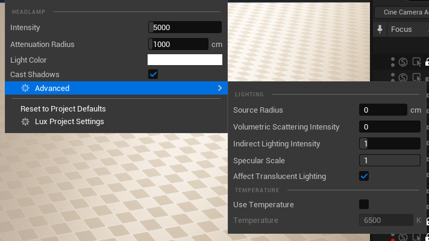

# Lux

**Level Editor Headlamp**

Lux adds a configurable headlamp directly to Unreal Engine's **Level Editor viewport toolbar**. Illuminate dark interiors, inspect materials and geometry, and navigate scenes without placing a Light Actor or changing level content. The light follows the perspective viewport you're working in, with native Slate controls for brightness, reach, color, shadows, and additional point-light properties.

Lux is an **editor-only** utility. It does not add a gameplay lighting system or content to packaged builds.


*The same Level Editor scene with Lux disabled (left) and enabled (right). The lighting is temporary and is not saved with the level.*

---

## What is Lux?

Lux is a camera-following **movable point light** for inspecting levels as you work. It is especially useful when your scene is too dark to navigate comfortably, but changing placed lights or exposure would interfere with the lighting you're authoring.

- **Toggle light from the viewport toolbar.** The icon is gray while inactive and Unreal's Accent Blue while active.
- **Illuminate the viewport you're using.** The headlamp tracks the camera position of the most recently interacted perspective Level Editor viewport.
- **Adjust lighting immediately.** Change intensity, attenuation radius, color, and shadows without opening an Actor's Details panel.
- **Access secondary controls when needed.** Advanced provides source radius, volumetric and indirect contribution, specular, translucent lighting, and color temperature.
- **Set project defaults and personal preferences separately.** Project Settings define defaults and the allowed intensity/radius ranges; your last-used headlamp values are stored as editor user preferences.
- **Keep the level unchanged.** Lux manages a transient light component in the Editor world rather than adding a persistent Actor.

---

# Features

### Native viewport toolbar

Lux appears as the **first control in the right-anchored Level Editor viewport toolbar group**, immediately before the other right-side viewport controls. It uses the same native toolbar and menu systems as Unreal's built-in editor tools.

| Control | Behavior |
|---|---|
| Lux icon | Toggle the headlamp on or off. Gray indicates inactive; Accent Blue indicates active. |
| Dropdown arrow | Open Lux settings without toggling the light. |
| Hover | Show the standard Unreal tooltip for the selected control. |

The icon and dropdown form a compact pair with matching button heights, but retain **independent click targets**. The icon is the state indicator; there is no separate status window or tab.

### Active viewport following

Lux maintains **one headlamp**, which follows the current perspective Level Editor viewport. It remembers the viewport you interact with rather than relying only on Unreal's global active-viewport pointer.

- Interact with a perspective viewport to make it the headlamp target.
- Move or navigate that camera; the point light follows its **position**.
- Interact with another perspective viewport to transfer the light to that camera.
- Orthographic views do not move the light to their camera positions.
- PIE and game viewports are not headlamp targets.

A point light emits in all directions, so Lux does not need to track the camera's rotation. The light is shared by the Editor world, which means its illumination can also be visible in other lit Level Editor viewports. See **Limitations** for more details.

### Everyday light controls

The primary dropdown keeps the four most frequently used properties available:

| Property | Purpose | Initial default |
|---|---|---|
| **Intensity** | Control the point light's brightness. | `5,000` |
| **Attenuation Radius** | Control how far the light reaches. | `1,000 cm` |
| **Light Color** | Set the light color using Unreal's native color picker. | White |
| **Cast Shadows** | Enable or disable dynamic shadows from the headlamp. | Enabled |

Numeric controls support Unreal's normal **drag-to-scrub** and direct-entry interactions. All changes apply immediately, even if the headlamp is currently turned off; the values will be used the next time it is enabled.

### Advanced light controls

**Advanced** is a native submenu containing secondary properties, grouped into **Lighting** and **Temperature**. These are available without expanding the primary menu into a full Details panel.

| Section | Property | Purpose | Initial default |
|---|---|---|---|
| Lighting | Source Radius | Adjust the apparent light-source radius for supported highlights and shadow softness. | `0 cm` |
| Lighting | Volumetric Scattering Intensity | Adjust the light's contribution to supported volumetric fog. | `0` |
| Lighting | Indirect Lighting Intensity | Scale supported indirect-light contribution. | `1` |
| Lighting | Specular Scale | Scale the light's specular reflection contribution. | `1` |
| Lighting | Affect Translucent Lighting | Allow the light to affect supported translucent materials. | Enabled |
| Temperature | Use Temperature | Combine a blackbody temperature tint with the selected Light Color. | Disabled |
| Temperature | Temperature | Set the color temperature in Kelvin. | `6,500 K` |

**Temperature is only editable when Use Temperature is enabled.** Volumetric, indirect, translucent, and certain shadow effects depend on the renderer, project settings, and scene content.

### Project defaults and per-user values

Project Settings define the project's initial headlamp properties, including configurable minimum and maximum **Intensity** and **Attenuation Radius** values. Individual developers can adjust their headlamp without changing those shared defaults.

**Reset to Project Defaults** restores all light properties, including Advanced properties, to the project's configured defaults. The reset does not turn Lux on or off.

### Editor-only behavior

Lux creates a transient, movable point-light component in the Editor world. There is no placed Light Actor to manage in the World Outliner, and the temporary headlamp is not serialized into a level or cooked into a game.

---



*The viewport menu gives quick access to common settings and opens a separate Advanced submenu for less frequent adjustments.*

---

# Using Lux

Lux is controlled directly from a **perspective Level Editor viewport**. No Editor Utility Widget or separate editor window is required.

### Turn the headlamp on or off

1. Open a level in Unreal Editor.
2. Locate the **Lux icon** at the beginning of the right-anchored viewport toolbar group.
3. Click the icon to enable the headlamp. It changes to **Accent Blue**.
4. Navigate the perspective viewport. The light follows the camera, illuminating nearby surfaces.
5. Click the icon again to disable the headlamp. It returns to gray.

The headlamp starts **disabled** whenever Unreal Editor launches. Its light-property values are remembered independently of the enabled state.

### Adjust the headlamp

1. Click the **dropdown arrow** beside the Lux icon.
2. Drag the Intensity or Attenuation Radius value to scrub, or click the value to enter a number.
3. Select **Light Color** to open Unreal's color picker.
4. Toggle **Cast Shadows** if you want to inspect the area with or without dynamic shadowing.
5. Open **Advanced** for secondary lighting and temperature controls.

The menu uses Unreal's native property widgets. There is no Apply button. The project's configured intensity and radius limits are enforced when editing those values.

### Move between viewports

With a layout containing multiple Level Editor viewports, click or navigate within the **perspective viewport** you want to inspect. Lux follows the perspective camera associated with that interaction.

When you switch to an orthographic viewport, Lux does not relocate the light to the orthographic camera. It remains a **single light in the shared Editor world**, rather than independent per-viewport illumination.

### Reset your light settings

Choose **Reset to Project Defaults** in the Lux dropdown to restore Intensity, Attenuation Radius, Light Color, Cast Shadows, and every Advanced property.

To change what Reset restores, select **Lux Project Settings**. This opens **Edit > Project Settings > Plugins > Lux** directly.

### Example workflows

- **Inspecting an unlit interior:** Enable Lux, increase Attenuation Radius until the nearby geometry is visible, then adjust Intensity for readability. Disable Lux when you want to judge the level's authored lighting again.
- **Checking shadow behavior:** Keep the camera in place and toggle Cast Shadows to distinguish missing illumination from occlusion by nearby geometry.
- **Reviewing material response:** Adjust Light Color, Source Radius, or Specular Scale to check how surfaces respond to illumination and reflections.
- **Inspecting fog or translucent materials:** Open Advanced to adjust Volumetric Scattering Intensity or Affect Translucent Lighting. The result depends on the project's rendering setup.
- **Working across viewports:** Click the perspective viewport you want to inspect. Lux follows that camera without requiring a separate light setup for each view.

---

# Light Properties

This section explains what each Lux control changes. All properties operate on the same temporary point light, not on the lights already placed in your level.

## Intensity

Intensity controls the brightness of Lux's point light. Use higher values when navigating dark spaces and lower values when you only need enough illumination to inspect nearby surfaces.

The editable range is determined by **Minimum Intensity** and **Maximum Intensity** under Project Settings. Values outside those bounds are constrained to the configured range.

## Attenuation Radius

Attenuation Radius controls the maximum influence distance of the point light, in **centimeters**. A larger radius illuminates more of the nearby level; a smaller radius is useful when you want localized lighting while inspecting a specific object or surface.

It is separate from Intensity: **Intensity affects brightness; Attenuation Radius affects reach.** Project Settings control the minimum and maximum allowable radius.

Increasing the radius while dynamic shadows are enabled can increase lighting cost.

## Light Color

Light Color controls the headlamp's RGB color. Click the swatch to open Unreal's native color picker. Lux uses the selected color without editing any existing Light Actors or materials.

When **Use Temperature** is enabled, Unreal combines the temperature tint with this color. Setting Light Color to white makes it easier to judge the temperature value by itself.

## Cast Shadows

Cast Shadows determines whether Lux produces supported dynamic shadows. With shadows disabled, the light can illuminate areas without objects blocking its contribution in the same way; with shadows enabled, you can inspect shape and occlusion more naturally.

Movable point-light shadows can be relatively expensive, especially at larger attenuation radii. Disable them when you need inspection light but do not need shadow detail.

## Advanced: Lighting

### Source Radius

Source Radius represents the apparent size of the point-light source. It can change highlights and supported shadow softness. The initial value is **0 cm**, which behaves as a point-like source.

Source Radius does not increase the maximum area illuminated. Use **Attenuation Radius** for that.

### Volumetric Scattering Intensity

This scales Lux's contribution to supported volumetric fog. A value of **0** removes the headlamp's volumetric scattering contribution, while leaving its direct illumination available.

The setting has no visible volumetric effect without a compatible fog and rendering setup.

### Indirect Lighting Intensity

This multiplies Lux's supported indirect-light contribution. **0** disables that indirect contribution; **1** uses the normal multiplier. The visible result depends on the active lighting and rendering systems.

This is not a substitute for a global illumination solution and will not necessarily change the appearance of every scene.

### Specular Scale

Specular Scale adjusts the specular contribution of Lux from **0 to 1**. Use a lower value to reduce distracting reflections while examining surface color or geometry; use **1** for the normal contribution.

It changes Lux's contribution only, not the underlying material parameters or reflections produced by other lights.

### Affect Translucent Lighting

This controls whether Lux contributes to supported translucent material lighting. It can be useful when inspecting translucent surfaces or effects and can have a rendering cost depending on the scene.

Some translucent materials and render paths may not respond visibly to this setting.

## Advanced: Temperature

### Use Temperature

Use Temperature enables a blackbody color-temperature tint for Lux. It works **in combination with Light Color**, rather than replacing the selected color.

### Temperature

Temperature sets that tint in **Kelvin**. Lower values produce a warmer appearance and higher values generally produce a cooler appearance. The control becomes available only when Use Temperature is enabled.

---

# Project Settings

Open **Edit > Project Settings > Plugins > Lux**, or select **Lux Project Settings** from the viewport dropdown.

These settings provide **project-wide limits and reset values**. They use Unreal's standard Project Settings categories and property editors. The initial values below describe the plugin's built-in defaults; your project can choose different values.

## Intensity

| Setting | Initial value | Purpose |
|---|---:|---|
| Minimum Intensity | `0` | Lowest intensity allowed in the viewport menu. |
| Maximum Intensity | `50,000` | Highest intensity allowed in the viewport menu. |
| Default Intensity | `5,000` | Intensity restored by Reset to Project Defaults. |

## Attenuation Radius

| Setting | Initial value | Purpose |
|---|---:|---|
| Minimum Attenuation Radius | `0 cm` | Smallest allowed influence radius. |
| Maximum Attenuation Radius | `10,000 cm` | Largest allowed influence radius. |
| Default Attenuation Radius | `1,000 cm` | Radius restored by Reset to Project Defaults. |

## Light Defaults

| Setting | Initial value |
|---|---|
| Default Light Color | White |
| Default Cast Shadows | Enabled |

## Advanced Defaults

| Setting | Initial value |
|---|---|
| Default Source Radius | `0 cm` |
| Default Volumetric Scattering Intensity | `0` |
| Default Indirect Lighting Intensity | `1` |
| Default Specular Scale | `1` |
| Default Affect Translucent Lighting | Enabled |
| Default Use Temperature | Disabled |
| Default Temperature | `6,500 K` |

**The minimum, maximum, and default values are related.** Unreal constrains the default Intensity and Attenuation Radius to the corresponding project range. If the project changes those bounds, Lux also constrains saved user values that fall outside the new range.

The other Advanced properties use their supported ranges in the plugin; the project settings above provide their reset values, not separate configurable minimum/maximum bounds for each one.

**Changing a project default does not automatically reset everyone's current headlamp adjustments.** Developers can use Reset to Project Defaults when they want to adopt the configured default values.

---

# Saving Lux Settings

Lux separates shared project configuration from each developer's personal headlamp values.

| Kind of state | Where it belongs | Behavior |
|---|---|---|
| Project minimums, maximums, and defaults | `Config=Editor` project configuration | Shared configuration used for limits, initialization, and reset. |
| Last-used light properties | `EditorPerProjectUserSettings` | Personal editor preferences remembered between sessions. |
| Headlamp on/off state | Current Editor session | Always starts **off** when the Editor launches. |
| Actual temporary light | Transient Editor-world component | Not saved into level or Actor packages. |

Lux saves user values shortly after adjustments rather than writing the preferences file continuously during a numeric scrub. When the Editor closes normally, pending settings are also saved.

Use Unreal's ordinary source-control workflow for project configuration if you want other developers to receive the same project defaults. Personal Lux preferences do not need to be committed with level content.

### Reset behavior

**Reset to Project Defaults** restores all of the headlamp properties. It does not delete project configuration, alter placed lights, or change whether Lux is enabled.

---

# Installation

Lux is a **Windows 64-bit Editor plugin** for Unreal Engine 5.8.x. Use a package that matches your Unreal Engine version and installation method.

## Fab / Epic Games Launcher

> Use this method if Lux is available in your Fab library for your selected engine version.

1. Add **Lux** to your Fab library.
2. Open the **Epic Games Launcher** and locate the plugin in your library.
3. Install it for a compatible Unreal Engine version.
4. Launch your Unreal Engine project.
5. Open **Edit > Plugins**, search for **Lux**, and enable it if necessary.
6. Restart Unreal Editor if prompted.

When enabled, the Lux icon appears in the right-anchored Level Editor viewport toolbar.

## GitHub Release

For a prepared package, visit the repository's **Releases** page:

[https://github.com/mippi-the-dork/Lux/releases](https://github.com/mippi-the-dork/Lux/releases)

1. Download a release package compatible with your Unreal Engine 5.8 installation and Windows 64-bit.
2. Close Unreal Editor.
3. Extract the complete `Lux` folder into your project's `Plugins` directory.
4. Enable Lux in **Edit > Plugins** if necessary, and restart the Editor if prompted.

The expected project layout is:

```text
YourProject/
├── Config/
├── Content/
├── Plugins/
│   └── Lux/
│       ├── Doc/
│       ├── Resources/
│       ├── Source/
│       └── Lux.uplugin
└── YourProject.uproject
```

Do not nest the plugin folder as `Plugins/Lux/Lux/`. A source package requires compilation against a compatible Unreal Engine installation; a precompiled package may have different build requirements.

## GitHub Source

Developers who want to build or modify Lux can clone the repository directly:

[https://github.com/mippi-the-dork/Lux](https://github.com/mippi-the-dork/Lux)

### Requirements

- Unreal Engine **5.8.x**.
- Windows 64-bit and a matching Visual Studio C++ toolchain.
- A C++ Unreal Engine project, or an otherwise configured environment capable of building editor plugins.

### Clone and build

1. Close Unreal Editor.
2. From your project's `Plugins` directory, clone the repository:

   ```bash
   git clone https://github.com/mippi-the-dork/Lux.git
   ```

3. If required, right-click the `.uproject` file and choose **Generate Visual Studio project files**.
4. Open the Visual Studio solution and build your project's **Editor** target for **Win64 / Development Editor**.
5. Launch the project, enable Lux in **Edit > Plugins** if necessary, and restart when prompted.

If Lux is installed by manually copying a folder, replace the **complete** `Plugins/Lux` folder when installing another package. Mixing source files from different packages can leave outdated code or assets in the plugin directory.

---

# Compatibility

| | |
|---|---|
| **Lux Version** | 2.0.10 |
| **Unreal Engine** | 5.8.x |
| **Platform** | Windows 64-bit |
| **Plugin Type** | Editor |
| **Runtime Dependency** | None |
| **Packaged Game Impact** | None |
| **Interface** | Native Slate and ToolMenus |

The plugin descriptor targets Unreal Engine 5.8 and allows the Win64 platform. Compatibility with other Unreal Engine versions and platforms should not be assumed unless specifically tested and documented.

---

# How Lux Works

Lux extends Unreal Engine's native Level Editor viewport toolbar and manages its headlamp through an editor subsystem.

1. The toolbar displays Lux's SVG icon and settings arrow using native **Slate** widgets.
2. Clicking the icon updates the subsystem's enabled state.
3. Lux resolves the currently interacted **perspective Level Editor viewport**, with an appropriate initial fallback when no viewport has been tracked yet.
4. When enabled and a valid Editor world and perspective viewport are available, Lux creates a **transient movable Point Light Component** at the camera's location.
5. As that camera moves, Lux updates the light's position. It does not move the light for camera rotation alone.
6. Changes made through the menus update the temporary light and the editor user's saved preferences.
7. When Lux is disabled or its Editor world is being cleaned up, the light component is destroyed. The enabled state can remain available across level changes while the component is recreated for the active Editor world when appropriate.

No placed Light Actor is required. Lux does not replace other Level Editor tools, render custom viewport lighting passes, or modify Engine source code.

### Source overview

| Source | Responsibility |
|---|---|
| `Lux.cpp` | Module setup, toolbar registration, and placement in the right-anchored group. |
| `SLuxViewportControl.cpp` | Native toggle button, menu, Advanced submenu, color picker, and property controls. |
| `LuxViewportTracker.cpp` | Slate-input-based perspective viewport interaction tracking. |
| `LuxEditorSubsystem.cpp` | Headlamp lifecycle, camera tracking, immediate light-property changes, and user preferences. |
| `LuxProjectSettings.cpp` | Project-setting validation and response to changed limits. |
| `LuxUserSettings.h` | Individual user's stored headlamp properties. |
| `LuxStyle.cpp` | Native registration of the SVG toolbar icon. |

---

# What Lux Does Not Do

Lux is an **editor inspection light**, not a replacement for a project's authored lighting or runtime illumination.

It does not:

- Place or save a Light Actor in the level.
- Change an existing light's settings or the level's baked lighting.
- Add a gameplay flashlight, camera light, or runtime lighting component to packaged games.
- Create independent light instances or isolated rendering for each viewport.
- Follow orthographic or PIE/game cameras.
- Project a directional spotlight beam. Its light is omnidirectional.
- Override the project's renderer, exposure, fog, translucency, or shadowing requirements.

---

# Limitations

### Shared Editor world

Lux uses one light component in the shared Editor world. A light following one perspective viewport may also illuminate the scene when viewed through another lit Level Editor viewport. This is not a per-viewport lighting override.

### Perspective-only tracking

The headlamp is intended for perspective Level Editor cameras. Orthographic, PIE, and game viewports do not become headlamp targets. Switching viewport layouts may cause Lux to select another available perspective viewport when its previous target is no longer valid.

### Lighting and render support

The visible effect of **Indirect Lighting Intensity**, **Volumetric Scattering Intensity**, **Affect Translucent Lighting**, and certain shadow/source properties depends on the renderer, materials, and scene configuration. Values can change correctly even when a particular scene does not visibly respond.

### Performance

Dynamic movable point-light shadows can be expensive. Large Attenuation Radius values and additional translucent or volumetric contributions may increase rendering cost. Lux is intended as a temporary editing aid; use only the options required for the inspection task.

### Project and user configuration

Project defaults and editor-user preferences are separate. Changing a project default does not automatically overwrite a developer's current settings, except where current values must be constrained to the project's allowed intensity or radius limits.

---

# Troubleshooting

## Lux Does Not Appear in the Viewport Toolbar

1. Open **Edit > Plugins** and confirm Lux is enabled.
2. Restart Unreal Editor if the plugin was enabled during the current session.
3. Confirm you are using the **Level Editor viewport**, not a separate asset editor or game viewport.
4. Check that you are running a supported Unreal Engine and platform, and that any required source build completed successfully.
5. Look for Lux at the **left edge of the right-anchored viewport control group**.

## The Icon Is Blue but the Scene Is Not Illuminated

- Confirm that a valid **perspective Level Editor viewport** is active.
- Check **Intensity** and **Attenuation Radius**. An intensity of zero or a very small radius may provide no useful visible illumination.
- Confirm the camera is close enough to the surfaces you want to inspect.
- Check renderer and exposure settings, which can change how light contributions appear.
- If you have just changed levels or viewport layouts, interact with the intended perspective viewport again.

## Lux Follows the Wrong Viewport

Click inside the perspective Level Editor viewport you want to use, then navigate its camera. Lux remembers the most recently interacted perspective viewport rather than creating a separate headlamp per viewport.

Orthographic viewports do not take control of the light.

## A Numeric Value Will Not Go Beyond a Certain Range

Open **Project Settings > Plugins > Lux** and inspect the Intensity or Attenuation Radius minimum/maximum values. Lux constrains those two properties to the project's configured range.

Advanced numeric properties have their own supported limits. Not all advanced bounds are exposed as configurable Project Settings.

## Temperature Is Disabled or Does Not Seem to Change the Color

Enable **Advanced > Temperature > Use Temperature** first. Temperature combines with Light Color, so choose a neutral Light Color if you want to evaluate temperature alone.

## An Advanced Property Does Not Change the View

Check whether the scene and rendering configuration support the property. For example, volumetric scattering requires a compatible volumetric fog setup, and indirect-lighting contribution depends on the active renderer.

## My Settings Did Not Persist

Lux saves light-property adjustments as **editor-per-project user preferences**, not level content. Check that you are working in the same project and that the Editor was closed normally after the changes. The enabled state intentionally starts off on each Editor launch.

If the project's allowed intensity or radius range changed, Lux may constrain a previously saved value when it is loaded.

## Lux Project Settings Opens the Wrong Page

The normal location is **Edit > Project Settings > Plugins > Lux**. The menu command is designed to open that section directly. If it does not, confirm that you are using the matching compiled plugin version and do not have duplicate Lux installations at both the project and Engine plugin paths.

---

# Reporting Bugs

If you encounter a problem, open an issue:

[https://github.com/mippi-the-dork/Lux/issues](https://github.com/mippi-the-dork/Lux/issues)

Include:

- Lux version and Unreal Engine version.
- Windows version and whether you installed from Fab, a GitHub Release, or source.
- Steps to reproduce the issue.
- Whether it occurs in one or multiple Level Editor viewports.
- The light property or toolbar control involved.
- Relevant screenshots, video, and Unreal Editor log output.

For lighting behavior, describe the project's renderer and whether the scene uses relevant fog, translucency, or shadow features. Clear reproduction steps make the problem easier to isolate.

---

# Feature Requests

Suggestions are welcome through [GitHub Issues](https://github.com/mippi-the-dork/Lux/issues). Describe the inspection workflow you want to improve, what Lux currently makes difficult, and the result you're trying to achieve.

---

# Contributions

Pull requests are welcome. For significant changes, opening an Issue first helps establish the intended behavior and compatibility with Unreal's native Level Editor workflows.

Lux keeps its editor UI and lighting behavior within the plugin; it does not require modifications to Unreal Engine source code.

---

# License

Lux's public GitHub repository is distributed under the **MIT License**. See the [repository license](https://github.com/mippi-the-dork/Lux/blob/main/LICENSE) for its terms.

---

# About

Lux is an Unreal Engine editor utility created by **Mippi the Dork**.

The plugin is built around a simple need: **sometimes you need to see the level without changing the lighting you're making.** Lux makes that possible directly from the viewport toolbar, with a temporary light that follows your working camera and stays out of your saved level content.

**Lux makes dark scenes easier to navigate and inspect while leaving authored lighting and packaged gameplay untouched.**
