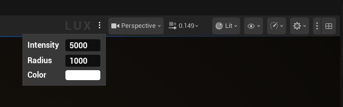

# Lux

### See the level. Leave its lighting alone.

**A camera-following headlamp for Unreal Engine's Level Editor.**

You've built a dark corridor, an unlit room, or an environment that's still waiting for its lighting pass. You need to examine the geometry and materials—but adding a temporary Light Actor, changing exposure, or turning up your authored lights means disrupting the very scene you're working on.

**Lux puts an inspection light exactly where you need it: at your editor camera.** Turn it on, move through your level, adjust the light, then turn it off. Your authored lighting stays as you left it.

---

## Light up your workspace, not your level

*Reveal the geometry you need to inspect without placing a light or changing the lighting you're creating.*

**Lux is useful when you need to:**

- **Navigate dark spaces** without interrupting the level's lighting setup.
- **Inspect geometry and materials** before the final lighting pass.
- **Check shadows and surface response** using a temporary, adjustable light.
- **Look at fog, translucency, and specular highlights** with additional point-light controls where supported by your renderer.
- **Switch between perspective Level Editor viewports** without placing or repositioning a Light Actor.
- **Return to the original look immediately** by switching Lux off.

No extra scene setup. No Light Actor to find and remove later. No gameplay lighting system to package.

## Everything you need, right in the viewport

Lux lives in the **right-anchored Level Editor viewport toolbar** and uses Unreal's native Slate controls. The compact icon and dropdown are separate:

- **Click the icon** to enable or disable the headlamp. Gray means off; Unreal's Accent Blue means on.
- **Click the arrow** to adjust the light without toggling it.

The headlamp follows the position of the perspective Level Editor camera you're using. It is a **movable point light**, so it illuminates in every direction rather than projecting a directional flashlight beam.

*One click brings inspection light into a dark scene; another returns you to the authored lighting.*

### Make the light your own

| Everyday controls | What they let you do |
| --- | --- |
| **Intensity** | Brighten or dim the headlamp |
| **Attenuation Radius** | Decide how far the light reaches |
| **Light Color** | Inspect the scene with a chosen light tint |
| **Cast Shadows** | Enable or disable supported dynamic shadows |

Need finer control? **Advanced** adds Source Radius, Volumetric Scattering Intensity, Indirect Lighting Intensity, Specular Scale, Affect Translucent Lighting, and color temperature controls.

You can also set **project-wide defaults and allowable intensity/radius ranges**, while individual developers keep their own preferred light values. The headlamp starts **off** each time Unreal Editor launches.

## Documentation — everything about Lux

**The [Lux Documentation Website](https://mippi-the-dork.github.io/Lux/) is the complete guide**, including installation, every setting, editor behavior, examples, troubleshooting, and source-level technical explanations.

This README is an introduction to what Lux can do. For instructions, expected behavior, and technical details, use the dedicated documentation:

| What you want to learn | Read this |
| --- | --- |
| **Install Lux and get started** | [Installation and compatibility](https://mippi-the-dork.github.io/Lux/?page=01-getting-started%2Finstall%2FDESIGN.md) · [First use](https://mippi-the-dork.github.io/Lux/?page=01-getting-started%2Ffirst-use%2FDESIGN.md) |
| **Find the toolbar and understand the toggle** | [Toolbar and Headlamp Toggle](https://mippi-the-dork.github.io/Lux/?page=02-headlamp-controls%2Ftoolbar%2FDESIGN.md) |
| **Adjust brightness, reach, color, and shadows** | [Everyday Light Controls](https://mippi-the-dork.github.io/Lux/?page=02-headlamp-controls%2Feveryday%2FDESIGN.md) |
| **Use the advanced lighting and temperature settings** | [Advanced Lighting](https://mippi-the-dork.github.io/Lux/?page=02-headlamp-controls%2Fadvanced-lighting%2FDESIGN.md) · [Color Temperature](https://mippi-the-dork.github.io/Lux/?page=02-headlamp-controls%2Ftemperature%2FDESIGN.md) |
| **Customize project defaults and personal preferences** | [Project Defaults](https://mippi-the-dork.github.io/Lux/?page=03-settings-and-preferences%2Fproject-defaults%2FDESIGN.md) · [Per-User Preferences](https://mippi-the-dork.github.io/Lux/?page=03-settings-and-preferences%2Fuser-preferences%2FDESIGN.md) |
| **Understand multi-viewport behavior** | [Viewport Following](https://mippi-the-dork.github.io/Lux/?page=04-workflows-and-implementation%2Fviewports%2FDESIGN.md) |
| **See real inspection workflows** | [Lighting Inspection Workflows](https://mippi-the-dork.github.io/Lux/?page=04-workflows-and-implementation%2Finspection-workflows%2FDESIGN.md) |
| **Solve an issue or see the implementation** | [Troubleshooting](https://mippi-the-dork.github.io/Lux/?page=05-support-and-troubleshooting%2Ftroubleshooting%2FDESIGN.md) · [Technical Architecture](https://mippi-the-dork.github.io/Lux/?page=04-workflows-and-implementation%2Farchitecture%2FTECHNICAL.md) |

**[Explore the full Lux documentation →](https://mippi-the-dork.github.io/Lux/)**

## Get Lux

Lux v2.0.10 is an **editor-only plugin for Unreal Engine 5.8.x on Windows 64-bit**.

- **[Fab](https://www.fab.com/listings/1e650e52-7265-44db-a8a5-65b8343df176)** — plugin listing.
- **[GitHub Releases](https://github.com/mippi-the-dork/Lux/releases)** — download available releases.
- **[Source code](https://github.com/mippi-the-dork/Lux)** — inspect, clone, or build from source.

For installation methods, engine compatibility, and updates, see the [installation guide](https://mippi-the-dork.github.io/Lux/?page=01-getting-started%2Finstall%2FDESIGN.md).

## What Lux doesn't do

Lux is a **lighting inspection tool**, not a replacement for authored level lighting.

- It **does not place or save a Light Actor** or modify existing lights or baked lighting.
- It **does not add a gameplay flashlight**, runtime lighting component, or packaged-game content.
- It **does not create a separate light for every viewport**. Lux uses one transient point light in the shared Editor world; its illumination may also be visible from another lit Editor viewport.
- It **does not follow orthographic, PIE, or game cameras**. Tracking is intended for perspective Level Editor viewports.
- It **does not project a focused spotlight beam**. The headlamp is an omnidirectional point light.
- It **does not override your renderer**, exposure, fog, materials, or supported shadow methods.

### Practical limitations

**Rendering:** Some Advanced properties, including volumetric, indirect, translucent and shadow-related effects, depend on the scene and render configuration. Changing a setting correctly doesn't guarantee a visible result in every project.

**Performance:** A movable point light with a large attenuation radius and dynamic shadows can have a meaningful rendering cost. Volumetric and translucent contributions may add more work depending on the project.

**Preferences:** Project defaults and each editor user's saved light properties are separate. Shared changes to permitted Intensity/Radius limits can constrain previously saved personal values. Lux's on/off state always starts disabled after an Editor restart.

For detailed explanations, read [How Lux Works](https://mippi-the-dork.github.io/Lux/?page=04-workflows-and-implementation%2Farchitecture%2FDESIGN.md) and the [Technical Architecture](https://mippi-the-dork.github.io/Lux/?page=04-workflows-and-implementation%2Farchitecture%2FTECHNICAL.md).

## Reporting bugs

Found something that doesn't behave as expected? **[Open an issue](https://github.com/mippi-the-dork/Lux/issues)** and include the Lux and Unreal Engine versions, Windows version, installation method, steps to reproduce, expected and actual behavior, and relevant screenshots or Editor logs.

For lighting issues, include the viewport arrangement, active rendering features, and the Lux setting involved. See [Troubleshooting](https://mippi-the-dork.github.io/Lux/?page=05-support-and-troubleshooting%2Ftroubleshooting%2FDESIGN.md) for common causes.

## Feature requests

**[Suggest an improvement through GitHub Issues](https://github.com/mippi-the-dork/Lux/issues).** Describe the workflow you're trying to improve, what currently gets in the way, and the result you'd like to achieve.

You can also see the [Lux Roadmap](https://mippi-the-dork.github.io/Lux/?page=ROADMAP.md) for documented priorities and future research directions. Unscheduled ideas are not promises of future features.

## Contributions

Contributions are welcome. For substantial changes, consider opening an Issue first to discuss the expected editor behavior and compatibility. Lux is built around Unreal's native editor tools and does not require Unreal Engine source modifications.

## License

Lux is distributed under the **MIT License**. See [LICENSE](LICENSE) for the full terms.

---

**Lux by Mippi the Dork.** When you need to see what you're building, the answer shouldn't have to be changing what you've built.

**[Documentation](https://mippi-the-dork.github.io/Lux/) · [Fab](https://www.fab.com/listings/1e650e52-7265-44db-a8a5-65b8343df176) · [Releases](https://github.com/mippi-the-dork/Lux/releases) · [Report an issue](https://github.com/mippi-the-dork/Lux/issues)**
