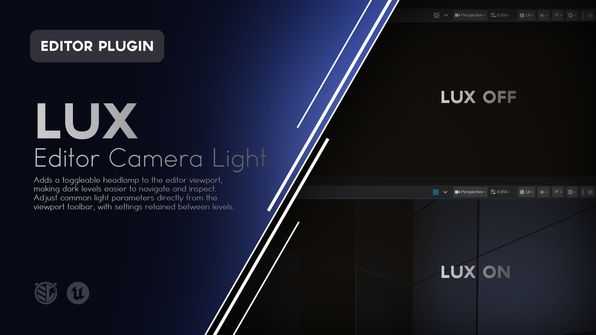
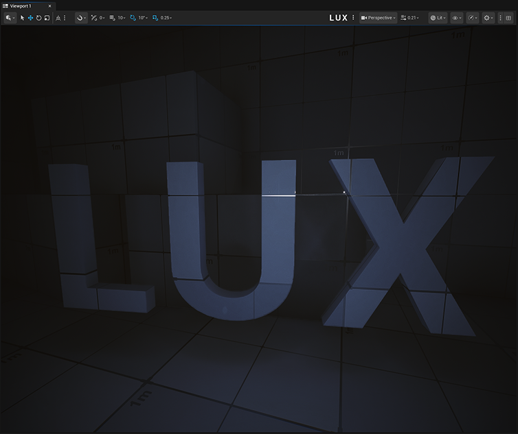
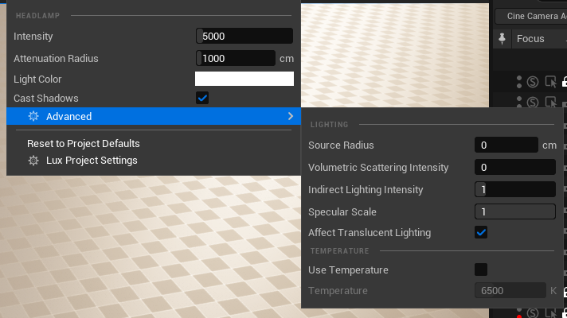

# Lux

**Level Editor Headlamp for Unreal Engine**

**See the level you're building without changing its lighting.**

Lux adds a configurable, camera-following headlamp directly to Unreal Engine's **Level Editor viewport toolbar**. Illuminate dark interiors, inspect geometry and materials, and move through unlit environments without placing temporary Light Actors or changing the scene's authored lighting.

    

  

---

## Dark levels shouldn't slow you down

You need to inspect a room before its lighting pass, find a problem inside a dark corridor, or check how a material responds to light. Turning up scene lights or adding temporary Light Actors works, but it also creates changes you have to manage or undo before getting back to the level you're actually building.

**Lux gives you the light you need for inspection, without touching the lights you author.**

- **Navigate dark environments.** Keep nearby geometry visible as you move the perspective Level Editor camera.
- **Skip temporary Light Actors.** The headlamp is a transient Editor component, not another object to place, save, or remove from the level.
- **Keep controls close.** Toggle Lux from the native viewport toolbar and adjust its properties in the neighboring dropdown.
- **Inspect the details.** Change brightness, reach, color, shadows, and supported advanced point-light effects when examining your scene.
- **Work with your own preferences.** Project defaults and allowed ranges are shared, while personal headlamp settings can stay yours.
- **Return to authored lighting instantly.** Turn Lux off to see the level without the inspection light.

  

## Explore the documentation

> ### [**Lux Documentation — Full User Guide and Technical Reference**](https://mippi-the-dork.github.io/Lux/)
>
> **Everything you need to understand and use Lux, in one place.** Get started, explore every headlamp property, learn how viewport following and user preferences behave, or find technical details and troubleshooting steps.
>
> **[Get Started](https://mippi-the-dork.github.io/Lux/?page=01-getting-started%2FREADME.md)** · **[Headlamp Controls](https://mippi-the-dork.github.io/Lux/?page=02-headlamp-controls%2FREADME.md)** · **[Settings & Preferences](https://mippi-the-dork.github.io/Lux/?page=03-settings-and-preferences%2FREADME.md)** · **[Troubleshooting](https://mippi-the-dork.github.io/Lux/?page=05-support-and-troubleshooting%2FREADME.md)**

This README introduces what Lux offers. **The [documentation website](https://mippi-the-dork.github.io/Lux/) is the maintained reference for installation, exact controls, viewport behavior, workflows, and technical implementation.**

## One headlamp. All the controls you need.

Click the **Lux icon** to toggle the light. The icon is gray when disabled and Unreal's Accent Blue when active. Click the **separate dropdown arrow** to adjust its properties without toggling the headlamp.

  

| Headlamp controls | What you can do |
| --- | --- |
| **[Intensity](https://mippi-the-dork.github.io/Lux/?page=02-headlamp-controls%2Feveryday%2FDESIGN.md)** | Brighten or dim the temporary light. |
| **[Attenuation Radius](https://mippi-the-dork.github.io/Lux/?page=02-headlamp-controls%2Feveryday%2FDESIGN.md)** | Control how far its illumination reaches. |
| **[Light Color](https://mippi-the-dork.github.io/Lux/?page=02-headlamp-controls%2Feveryday%2FDESIGN.md)** | Tint the inspection light without changing your material or level lights. |
| **[Cast Shadows](https://mippi-the-dork.github.io/Lux/?page=02-headlamp-controls%2Feveryday%2FDESIGN.md)** | Enable or disable supported dynamic point-light shadows. |
| **[Advanced Lighting](https://mippi-the-dork.github.io/Lux/?page=02-headlamp-controls%2Fadvanced-lighting%2FDESIGN.md)** | Adjust Source Radius, volumetric scattering, indirect lighting, specular response, and translucent lighting contribution. |
| **[Color Temperature](https://mippi-the-dork.github.io/Lux/?page=02-headlamp-controls%2Ftemperature%2FDESIGN.md)** | Enable temperature tint and choose a Kelvin value for warmer or cooler illumination. |

Lux uses **native Slate controls**, including numeric scrubbing, a color picker, and checkboxes. The same light follows the most recently interacted eligible perspective Level Editor camera.

## Useful in real production workflows

### See dark spaces before they're lit

Keep working in an unlit room or corridor without adjusting your authored lights. Set a comfortable Intensity and Attenuation Radius, then navigate the environment with the light following the editor camera.

  

*Select the image to watch the headlamp toggle demonstration.*

### Inspect materials and lighting response

Use neutral Light Color to evaluate surface response, toggle Cast Shadows to examine occlusion, or explore Advanced properties such as Source Radius and Specular Scale. Volumetric, indirect, and translucent effects depend on the renderer and scene setup.

  

### Work across perspective viewports

Lux follows the perspective **Level Editor viewport you're working in**. Interact with another eligible perspective viewport to change the camera it tracks. It uses one point light in the shared Editor world, so another lit viewport may still show illumination from that same light.

[**Learn how Lux chooses a viewport →**](https://mippi-the-dork.github.io/Lux/?page=04-workflows-and-implementation%2Fviewports%2FDESIGN.md)

### Keep preferences without changing your level

Set project-wide default values and allowed ranges for Intensity and Attenuation Radius. Each editor user can keep their own chosen headlamp values, or choose **Reset to Project Defaults**. Lux starts disabled when the Editor launches, regardless of those saved preferences.

[**Learn how project defaults and user settings work →**](https://mippi-the-dork.github.io/Lux/?page=03-settings-and-preferences%2FREADME.md)

## Get Lux

**Lux v2.0.10** targets **Unreal Engine 5.8.x on Windows 64-bit** and runs in the **Editor only**.

Choose a compatible release or install through Fab where available. Developers can also build from the full source code.

**[View on Fab](https://www.fab.com/listings/1e650e52-7265-44db-a8a5-65b8343df176)** · **[Download GitHub Releases](https://github.com/mippi-the-dork/Lux/releases)** · **[Installation Guide](https://mippi-the-dork.github.io/Lux/?page=01-getting-started%2Finstall%2FDESIGN.md)** · **[First Use](https://mippi-the-dork.github.io/Lux/?page=01-getting-started%2Ffirst-use%2FDESIGN.md)**

## Important limitations

Lux is an **Editor lighting-inspection utility**, not a runtime flashlight, replacement lighting system, or independently rendered light for each viewport.

- **One shared Editor-world light.** The headlamp is a transient movable Point Light Component, not a placed Actor. Its light may also be visible from other lit Editor viewports showing the same world.
- **Perspective Level Editor tracking only.** Lux doesn't follow orthographic, PIE, game, or asset-editor cameras.
- **Point light, not spotlight.** It illuminates in every direction; it doesn't project a focused flashlight beam.
- **Rendering features have prerequisites.** Exposure, fog, materials, GI, and shadow methods affect the result. Some Advanced settings may not visibly change the scene in a given renderer configuration.
- **Dynamic lighting has a cost.** Large attenuation radii, movable shadows, volumetric contributions, and translucency can affect editor rendering performance.
- **Personal values and project defaults are separate.** New shared limits may clamp a user's saved Intensity or Radius. The headlamp's enabled state resets off when the Editor restarts.
- **No packaged-game Lux runtime.** Lux doesn't author or save lighting into the map, change existing Light Actors, or provide gameplay flashlight functionality.

For more detail, see the [FAQ](https://mippi-the-dork.github.io/Lux/?page=05-support-and-troubleshooting%2Ffaq%2FDESIGN.md) and [Troubleshooting](https://mippi-the-dork.github.io/Lux/?page=05-support-and-troubleshooting%2Ftroubleshooting%2FDESIGN.md).

## What's next?

Lux v2.0.10 already provides native viewport controls, a camera-following Editor headlamp, everyday and advanced point-light properties, project defaults, and per-user preferences.

Future research may explore clearer multi-viewport feedback, improved lighting-inspection workflows, and better renderer-specific diagnostics. **These are opportunities under consideration, not announced features or scheduled releases.**

[**View the Lux Roadmap →**](https://mippi-the-dork.github.io/Lux/?page=ROADMAP.md)

## Issues, feature requests and contributions

Found a bug? Please [open an issue](https://github.com/mippi-the-dork/Lux/issues) with your Lux/Unreal versions, installation method, viewport arrangement, reproduction steps, and screenshots or Output Log excerpts where helpful.

Have an idea? [Submit a feature request](https://github.com/mippi-the-dork/Lux/issues) describing the editing problem, what you'd like Lux to do, and the result you're after.

**Pull requests are welcome.** For substantial changes, open an issue first to discuss scope and compatibility. Lux aims to remain a compact, native Unreal Editor tool without engine modifications.

## License

Lux is distributed under the **MIT License**. See [LICENSE](LICENSE) for the full terms.

---

**Lux is created by Mippi the Dork.**

**[Explore the Documentation](https://mippi-the-dork.github.io/Lux/)** · **[Get Lux](https://github.com/mippi-the-dork/Lux/releases)** · **[Report an Issue](https://github.com/mippi-the-dork/Lux/issues)**
