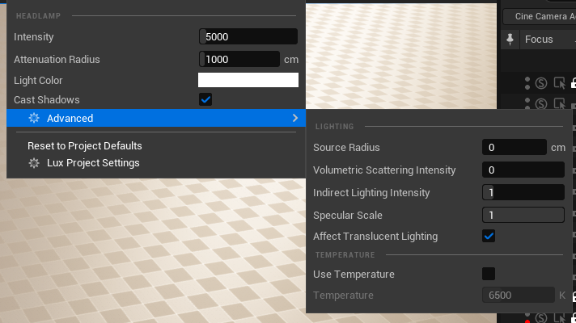

# Everyday Light Controls — Design

**Lux v2.0.10 · User guide**

## Four primary properties

Open the arrow beside Lux's toolbar icon to access the most common controls. They are **native Unreal Slate widgets** and apply immediately; there is no Apply button.

| Property | Initial value | What it changes |
| --- | --- | --- |
| **Intensity** | 5,000 | Brightness of the temporary point light |
| **Attenuation Radius** | 1,000 cm | Maximum influence reach of the light |
| **Light Color** | White | RGB tint using Unreal's native color picker |
| **Cast Shadows** | Enabled | Whether Lux casts supported movable point-light shadows |

*The Lux dropdown keeps the main inspection controls in one small native menu, with Advanced available separately.*

## How to change a value

Drag a numeric field to **scrub** or click/type a value directly. Intensity and Attenuation Radius obey the minimum/maximum configured in **Project Settings → Plugins → Lux**. Click the Light Color swatch to open Unreal's nonmodal color picker; click the Cast Shadows checkbox to toggle it.

<figure class="doc-media" data-kind="gif" data-media-id="everyday-scrubbing">

<figcaption>The headlamp's brightness and reach can be adjusted independently while viewing the effect.<strong>Capture instructions · GIF:</strong> Record Intensity being scrubbed up/down, then Attenuation Radius changing while keeping the camera fixed. Show the Lux native dropdown and nearby lit geometry throughout, with the two effects visible.</figcaption>
</figure>

## Intensity is not radius

Higher **Intensity** increases brightness. Larger **Attenuation Radius** lets the light influence more distant surfaces. A bright but tiny-radius light may leave a room dark beyond the camera, while a large-radius dim light can reach far but provide weak illumination.

## Shadows and color

Use shadows to examine shapes and occlusion; disable them when you need low-cost general inspection lighting. A large radius with movable point-light shadows can raise render cost. For a neutral reference, use a white Light Color; temperature tint can modify the resulting hue when enabled.

## Changes while disabled

You can adjust menu values while Lux is off. Those stored choices take effect the next time you enable the headlamp.

---

For specific Unreal properties and implementation paths, [read Technical](TECHNICAL.md).
