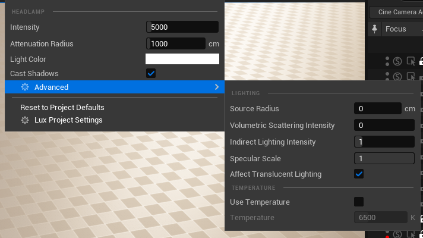

# Project Defaults and Limits — Design

**Lux v2.0.10 · User guide**

## Where are the project settings?

Open **Edit → Project Settings → Plugins → Lux**. You can also click **Lux Project Settings** at the bottom of the Lux viewport dropdown. These values establish shared starting/reset choices and the allowed Intensity and Attenuation Radius ranges; they are not the same as each developer's personal headlamp preferences.

*The viewport dropdown provides a direct route to the native Lux Project Settings section.*

## Limits and initial defaults

| Field | Built-in value | Purpose |
| --- | ---: | --- |
| Minimum / Maximum Intensity | 0 / 50,000 | Allowable Intensity range in Lux |
| Default Intensity | 5,000 | Reset target |
| Minimum / Maximum Attenuation Radius | 0 / 10,000 cm | Allowable reach in Lux |
| Default Attenuation Radius | 1,000 cm | Reset target |
| Default Light Color | White | Reset target |
| Default Cast Shadows | On | Reset target |

## Advanced reset defaults

Source Radius **0 cm**, Volumetric Scattering Intensity **0**, Indirect Lighting Intensity **1**, Specular Scale **1**, Affect Translucent Lighting **On**, Use Temperature **Off**, Temperature **6,500 K**.

<figure class="doc-media" data-kind="image" data-media-id="project-defaults-screen">

<figcaption>Lux Project Settings define shared range limits and the values used by Reset to Project Defaults.<strong>Capture instructions · Image:</strong> Capture Edit → Project Settings → Plugins → Lux in Unreal. Expand Intensity, Attenuation Radius, Light Defaults and Advanced Defaults so their built-in fields and values are visible, using two cropped panels if necessary.</figcaption>
</figure>

## Team workflow

Choose project limits large enough for normal level inspection but not so high that accidental scrubbing creates excessive illumination or shadow cost. Share the project settings through your usual source-control workflow. Developers can keep personal adjustments; they do not all reset just because a shared default changes.

**Exception:** If the team narrows the allowed Intensity/Radius range, Lux constrains user values that fall outside the new bounds.

---

For configuration classes and native save behavior, [read Technical](TECHNICAL.md).
