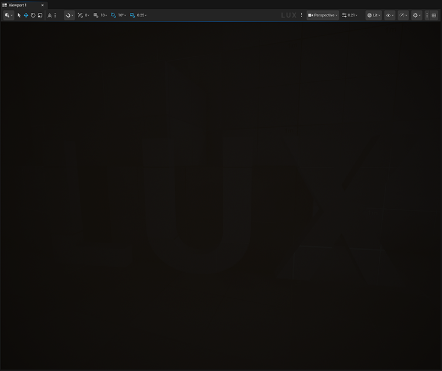
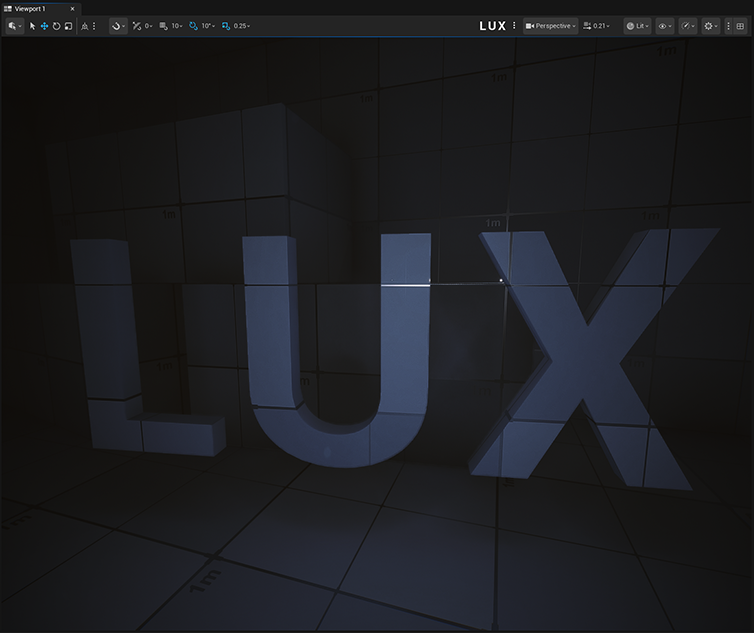

# Practical Lighting Inspection Workflows — Design

**Lux v2.0.10 · User guide**

## Workflow 1: navigate a dark interior

1. Open a dark interior in a perspective Level Editor viewport.
2. Turn Lux on with the icon.
3. Increase **Attenuation Radius** until the walls and upcoming spaces are visible.
4. Change **Intensity** separately to reach a comfortable brightness.
5. Navigate the space; Lux follows the camera without placing a light.
6. Disable Lux when you're ready to judge the authored lighting.

*The headlamp can reveal geometry in dark spaces without modifying the scene's authored lights.*

*With Lux off, the viewport shows the scene without the temporary inspection light.*

*Enabling Lux illuminates nearby geometry while preserving the original authored lights and materials.*

## Workflow 2: examine occlusion and shadows

Keep camera and light color fixed. Toggle **Cast Shadows** off and on. If illumination changes significantly, nearby geometry may be blocking the point light; if not, confirm that the renderer and surface setup support the expected shadow behavior.

## Workflow 3: study materials without distorting the source assets

Adjust **Light Color** to white for a neutral reference. Try **Source Radius** or **Specular Scale** while examining glossy objects. The changes affect Lux's own illumination, not the material properties or other scene lights.

<figure class="doc-media" data-kind="image" data-media-id="material-comparison">

<figcaption>Lux's color and specular settings help isolate material response without editing the material asset.<strong>Capture instructions · Image:</strong> Capture the same glossy and matte material samples in a perspective viewport under Lux, ideally as a labeled side-by-side comparison with different Specular Scale or Source Radius values. Keep all material properties unchanged.</figcaption>
</figure>

## Workflow 4: inspect fog and translucency

Configure compatible volumetric fog or translucent materials in your test level, then open **Advanced → Lighting**. Adjust **Volumetric Scattering Intensity** or **Affect Translucent Lighting** while observing the same scene. If nothing changes, check whether the chosen rendering path supports the requested property.

## Workflow 5: return to the level's real lighting

Click Lux off before evaluating final art direction, light placement, shadows and color balance. Lux is an inspection aid and should not be treated as authored environmental lighting.

---

For source implementation details, [read Technical](TECHNICAL.md).
