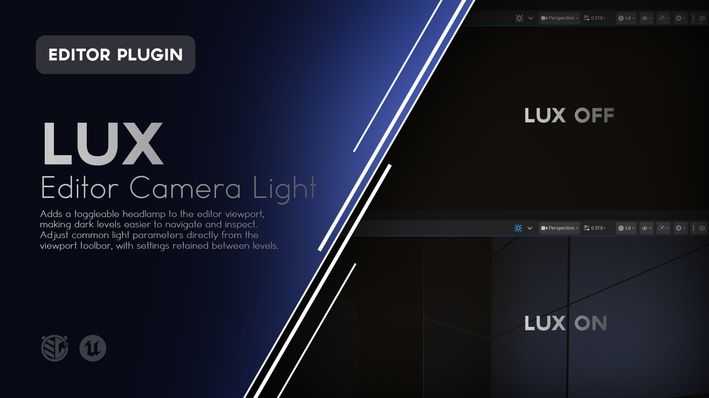

# Lux Documentation

**Lux v2.0.10 · Unreal Engine 5.8.x · Win64 · Editor-only**

Lux adds a configurable **headlamp to Unreal Engine's Level Editor viewport toolbar**. Illuminate dark interiors, inspect materials and geometry, and navigate a scene without placing a Light Actor or changing the lighting authored in your level.

*Lux gives the Level Editor camera its own temporary inspection light, available from Unreal's native viewport toolbar.*

## What can I do with Lux?

**See dark geometry:** Switch on a temporary point light and navigate the level using your perspective Level Editor camera.

**Change the lighting instantly:** Adjust Intensity, Attenuation Radius, Light Color and Cast Shadows through an unobtrusive native dropdown.

**Inspect more than brightness:** Explore source radius, specular response, volumetric fog, indirect contribution, translucency and color temperature through the Advanced submenu.

**Keep your level clean:** Lux does not place or serialize a Light Actor, change existing lights or add a gameplay light to packaged builds.

## Get started in three steps

1. [Install Lux](01-getting-started/install/DESIGN.md) for UE 5.8.x on Win64.
2. [Turn on the headlamp](01-getting-started/first-use/DESIGN.md) using the icon at the beginning of the right-anchored Level Editor viewport toolbar controls.
3. [Customize the light](02-headlamp-controls/everyday/DESIGN.md) from the separate settings arrow and turn it off to evaluate your authored scene lighting again.

*The temporary headlamp illuminates nearby surfaces for inspection while leaving the level's own lights unchanged.*

## Which guide do I read?

**Design** pages explain how to operate Lux, why you would use a control, expected results, workflows and common problems. **Technical** pages explain Unreal integration, native properties, configuration ownership, viewport selection and limitations grounded in the actual C++ source.

Each topic has its own Design and Technical page; they complement rather than duplicate one another.

## Explore the manual

| Section | Topics | What you'll find |
| --- | ---: | --- |
| [01. Getting Started](01-getting-started/README.md) | 3 | Purpose, installation and first use |
| [02. Headlamp Controls](02-headlamp-controls/README.md) | 4 | Toolbar, four everyday controls, Advanced Lighting and Temperature |
| [03. Settings and Preferences](03-settings-and-preferences/README.md) | 3 | Project defaults, personal settings and Reset |
| [04. Workflows and Implementation](04-workflows-and-implementation/README.md) | 3 | Multi-viewport behavior, inspection examples and technical architecture |
| [05. Support and Troubleshooting](05-support-and-troubleshooting/README.md) | 3 | FAQ, diagnostic steps and updating |

## Understand Lux's limits

Lux is **one movable, omnidirectional point light in the shared Editor world**. It follows the most recently interacted eligible **perspective Level Editor viewport**, but its lighting can also be visible through other editor views of the same world. It does **not** follow orthographic, PIE or game cameras.

The light's on/off state starts disabled every editor launch, even when your personal light-property settings have been remembered. Project defaults are separate from those per-user values. Advanced effects depend on the project's renderer, exposure, fog and materials; changes to a property do not guarantee a visible difference in every scene.

## What's next?

The [Lux Roadmap](ROADMAP.md) records the currently documented version and carefully distinguishes existing capabilities from potential future ideas. It does not assign release numbers or dates to unapproved features.

The [Documentation Audit](DOCUMENTATION_AUDIT.md) and [Verification Matrix](VERIFICATION_MATRIX.md) track remaining media captures and tests. Their status is explicit: reviewing source does not count as passing a live Unreal Editor test.

## Project and support

[Lux source repository](https://github.com/mippi-the-dork/Lux) · [Releases](https://github.com/mippi-the-dork/Lux/releases) · [Issue tracker](https://github.com/mippi-the-dork/Lux/issues) · [MIT License](https://github.com/mippi-the-dork/Lux/blob/main/LICENSE)

**Documentation baseline:** Lux v2.0.10 repository source, plugin descriptor and README. Hands-on UE/browser verification remains separate from the source audit.
